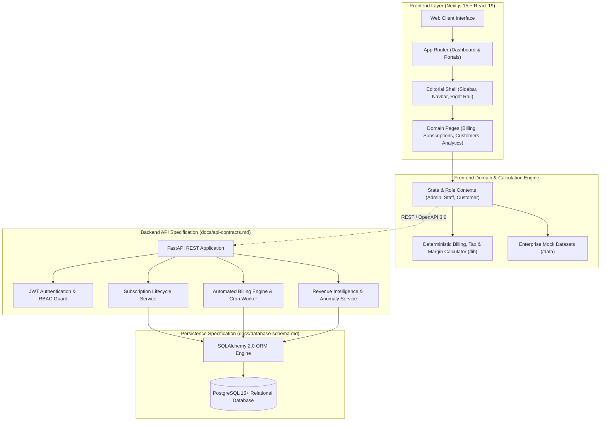

<div align="center">


# SUBSENSE

### *Turn Every Subscription Into Intelligent Revenue.*

**An enterprise-grade subscription operations and financial intelligence platform designed to eliminate manual spreadsheet chaos, automate multi-cycle recurring billing, and deliver high-precision revenue insights.**

<br />

[](https://nextjs.org/)
[](https://react.dev/)
[](https://www.typescriptlang.org/)
[](https://tailwindcss.com/)
[](https://fastapi.tiangolo.com/)
[](https://www.postgresql.org/)

<br />

[Explore Features](#4-feature-showcase) •
[System Architecture](#5-visual-system-architecture) •
[Subscription Lifecycle](#6-subscription-lifecycle) •
[Technology Stack](#7-technology-stack) •
[Quick Start](#9-installation-experience) •
[Project Roadmap](#13-roadmap)

---

</div>

<br />

## 1. Executive Summary

| Attribute | Details |
| :--- | :--- |
| **Product Name** | **SUBSENSE** |
| **Primary Tagline** | *Your Subscriptions. Your Revenue. Your Intelligence.* |
| **Category** | Intelligent Subscription & Recurring Revenue Management Platform |
| **Target Audience** | B2B SaaS, IT Managed Service Providers (MSPs), Cloud Agencies & SMEs |
| **Core Engineering Team** | **Team SENTINELS** |
| **Institution** | **KGiSL Institute of Technology** |
| **Academic Year** | **2026–2027** |

SUBSENSE addresses the critical financial breakdown that recurring-revenue businesses face when scaling: untracked subscription modifications, missed contract renewal windows, invoice discrepancies, slow payment collections, and blind revenue forecasting. Built with a high-end luxury editorial interface and a deterministic calculation engine, SUBSENSE unifies every subscription lifecycle touchpoint into a single pane of glass.

---

## 2. Visual Identity & Brand System

SUBSENSE adheres to an editorial minimalism palette curated for financial operations:

<div align="center">

| Swatch | Color Name | Hex Code | Purpose & Application |
| :---: | :--- | :---: | :--- |
|  | **Dark Espresso** | `#352C29` | Primary command sidebar, high-contrast headings, text surfaces |
|  | **Warm Stone Grey** | `#9D9695` | Secondary captions, icon accents, muted metadata, neutral states |
|  | **Deep Burgundy** | `#541415` | Administrative highlights, executive badges, focus accents |
|  | **Crimson Red** | `#D93645` | Primary action triggers, key metric highlights, urgent renewal alerts |
|  | **Soft Blush** | `#E8DAD5` | Border dividers, subtle card backdrops, secondary panels |
|  | **Warm Ivory** | `#F5F1ED` | Main workspace canvas, eye-fatigue reducing editorial background |

</div>

---

## 3. The Problem We're Solving

Modern subscription businesses frequently run billing operations on ad-hoc spreadsheets, legacy ERP add-ons, or disconnected payment gateways. This leads to severe operational friction and revenue leakage:

```
┌──────────────────────────────────────────────┐       ┌──────────────────────────────────────────────┐
│        THE SPREADSHEET BOTTLENECK            │  ──►  │            THE SUBSENSE SOLUTION             │
├──────────────────────────────────────────────┤       ├──────────────────────────────────────────────┤
│ ✕ Fragmented customer & tier sheets          │       │ ✓ Unified real-time subscriber ledger        │
│ ✕ Missed renewal windows & delayed follow-up │       │ ✓ Automated renewal risk radar & notices     │
│ ✕ Error-prone manual invoice calculations    │       │ ✓ Idempotent, zero-touch recurring billing  │
│ ✕ Multi-rail payment reconciliation friction │       │ ✓ Real-time multi-cycle cashflow audit trail │
│ ✕ Zero visibility into forward-looking MRR   │       │ ✓ High-precision financial metrics (ARR/MRR) │
│ ✕ Undetected churn risk until after loss     │       │ ✓ Health score heuristics & anomaly detection│
└──────────────────────────────────────────────┘       └──────────────────────────────────────────────┘
```

---

## 4. Feature Showcase

SUBSENSE separates subscription operations into three tightly integrated functional domains:

### 4.1 Revenue Operations

| Feature Module | Business Impact | Status |
| :--- | :--- | :---: |
| **Customer Directory** | Complete B2B account profiles with credit terms, billing addresses, and tax identifiers. | ✅ Implemented |
| **Product & Variant Catalog** | Support for core services, software seats, tiered variants, and consumable add-ons. | ✅ Implemented |
| **Subscription Plan Matrix** | Flexible billing frequencies (Daily, Weekly, Monthly, Yearly) with auto-close and pause controls. | ✅ Implemented |
| **Quotation Engine** | Formally structured commercial proposals with validity countdowns and one-click subscription conversion. | ✅ Implemented |
| **Subscription Lifecycle** | Five-stage state machine (`Draft` → `Quotation` → `Confirmed` → `Active` → `Closed`). | ✅ Implemented |

### 4.2 Financial Operations

| Feature Module | Business Impact | Status |
| :--- | :--- | :---: |
| **Automated Recurring Billing** | Cycle-aware billing runs that generate non-duplicate draft invoices for all active accounts. | ✅ Implemented (Engine in `/lib`) |
| **Invoice Management** | Complete lifecycle management (`Draft` → `Confirmed` → `Paid` / `Cancelled`) with PDF simulation. | ✅ Implemented |
| **Payment Reconciliation** | Multi-method transaction ledger (Stripe, Bank Wire, Credit Card, ACH) with remaining balance tracking. | ✅ Implemented |
| **Tax Configuration** | Multi-jurisdiction tax rate rules with support for compound calculation and regional exemptions. | ✅ Implemented |
| **Discount Rule Engine** | Percentage and fixed deductions with date ranges, minimum quantity floors, and usage limits. | ✅ Implemented |

### 4.3 Smart Renewal Management

| Feature Module | Business Impact | Status |
| :--- | :--- | :---: |
| **Upcoming Renewal Tracking** | Surfaces subscriptions approaching expiry so teams can act before churn risk rises. | ✅ Implemented |
| **Next Billing & Renewal Date Engine** | Calculates contract renewals and next billing windows using plan frequency logic. | ✅ Implemented |
| **Configurable Reminder Schedule** | Generates 7, 3, and 1-day warnings before renewals to prevent missed action windows. | ✅ Implemented |
| **Renewal History Ledger** | Maintains an auditable sequence of previous renewals and duplicate-prevention checks. | ✅ Implemented |
| **Renewal API Layer** | Exposes endpoints for frontend integrations and operational automation. | ✅ Implemented |

### 4.4 Revenue Intelligence Layer

| Feature Module | Business Impact | Status |
| :--- | :--- | :---: |
| **AI Finance Assistant** | Contextual natural-language interface for instant financial queries and scenario simulations. | 🚧 In Progress (Interactive UI Active) |
| **Smart Renewal Risk Detection** | Heuristic radar scoring accounts based on tenure, past payment speed, and engagement health. | ✅ Implementedd |
| **Invoice Anomaly Detection** | Rule-based engine identifying statistical outliers, mismatched discounts, and erratic billing values. | ✅ Implemented |
| **Subscription Health Score** | Normalized 0–100 health composite rating customer risk and expansion readiness. | ✅ Implemented |
| **Automated Payment Notices** | Schedule-aware dunning reminders to preempt payment defaults and involuntary churn. | 📋 Planned |
| **Smart Discount Recommender** | Margin-aware discount recommendations preventing over-discounting on contract renewals. | 📋 Planned |

---

## 5. Visual System Architecture

SUBSENSE is structured around a decoupled, API-first architecture designed to scale seamlessly from frontend prototyping to enterprise distributed deployment:



---

## 6. Subscription Lifecycle

SUBSENSE enforces a strict, auditable state machine for all recurring contracts. Transitions prevent unauthorized billing and guarantee financial consistency:

```mermaid
stateDiagram-v2
    [*] --> Draft : Customer selects plan, variants & items
    Draft --> Quotation : Sales rep issues proposal with expiry date
    Quotation --> Confirmed : Customer accepts terms & pricing
    Quotation --> Closed : Expiry date elapsed without approval
    Confirmed --> Active : Activation date reached; billing schedule initiates
    Active --> Active : Periodic cycle elapses -> Automated Invoice Generated
    Active --> Closed : Contract term completed or early cancellation
    Closed --> [*]
```



### Invoicing & Payment Sub-Lifecycle

1. **Cycle Trigger**: When an `Active` subscription reaches its billing day, the engine creates a `Draft` invoice.
2. **Duplicate Prevention**: An idempotent period key `(subscription_id, period_start, period_end)` prevents duplicate billing runs.
3. **Confirmation**: Once reviewed, the invoice is marked `Confirmed`, locking line items, tax computations, and receivable totals.
4. **Settlement**: Recorded payments transition the invoice to `Paid`. If payments are partial, remaining balances are tracked on the customer ledger.

---

## 7. Technology Stack

SUBSENSE is built with modern, production-grade enterprise technologies:

### Frontend Architecture (Current Implementation)
- **Framework**: Next.js 15.5 with Turbopack App Router
- **UI Runtime**: React 19.1
- **Language**: TypeScript 5 (Strict Mode enabled)
- **Design System & Styling**: Tailwind CSS v4 with curated HSL luxury palette
- **Data Visualization**: Recharts 3.10 (Responsive MRR charts, renewal distribution, cashflow curves)
- **Component Primitives**: Lucide React 1.66 iconography, clsx, tailwind-merge
- **State Management**: React 19 Contexts for RBAC, personas, and notification streams

### Backend Architecture (Target Specification — `docs/`)
- **Web Framework**: Python 3.11+ with FastAPI (Asynchronous ASGI)
- **Database Engine**: PostgreSQL 15+
- **ORM & Migrations**: SQLAlchemy 2.0 + Alembic migration scripts
- **Authentication**: OAuth2 Password Bearer with JWT tokens & Argon2 password hashing
- **Precision Accounting**: Python `decimal.Decimal` arithmetic ensuring zero floating-point roundoff

---

## 8. Product Preview

<div align="center">

### *Inside SUBSENSE*

</div>

SUBSENSE delivers a unified workspace experience across all 16 operational routes:

```
┌──────────────────────────────────────────────────────────────────────────────────────────────────┐
│  SUBSENSE [NAVBAR: Dark Espresso #352C29 | Search | Notifications | Active Role: ADMIN ]         │
├────────────────────┬─────────────────────────────────────────────────┬───────────────────────────┤
│ ❖ SUBSENSE         │  DASHBOARD OVERVIEW                             │  QUICK METRICS            │
│                    │  • Total MRR: $128,450.00 (+12.4%)              │  • Active Subscriptions:  │
│ 📁 MANAGEMENT      │  • Annual Run Rate (ARR): $1,541,400.00         │    42 accounts            │
│  - Customers       │  • Net Revenue Retention: 114.2%                │  • Pending Invoices: 7    │
│  - Products        │                                                 │  • Avg Health Score: 87   │
│  - Plans           ├─────────────────────────────────────────────────┼───────────────────────────┤
│  - Quotations      │  MRR EXPANSION & REVENUE DISTRIBUTION (Recharts)│  RENEWAL RISK RADAR       │
│  - Subscriptions   │  [ Line chart showing Month-over-Month growth ] │  ▲ Apex Global (Score 42) │
│                    │                                                 │  ▼ NovaTech (Score 89)    │
│ 💳 FINANCE         ├─────────────────────────────────────────────────┼───────────────────────────┤
│  - Invoices        │  RECENT TRANSACTIONS & REVENUE BREAKDOWN        │  UPCOMING RENEWALS        │
│  - Payments        │  INV-2026-089  |  Acme Corp  |  $12,400  [PAID] │  • 3 contracts in 7 days  │
│  - Taxes           │  INV-2026-090  |  Starlight  |   $4,200  [PEND] │  • Value: $38,500.00      │
└────────────────────┴─────────────────────────────────────────────────┴───────────────────────────┘
```

> **Design Asset Verification**:
> Official branding assets are located in [`frontend/public/logo/`](file:///c:/Users/KiTE/OneDrive/Desktop/SUBSENSE/frontend/public/logo/):
> - `subsense-logo.png` — Official high-resolution primary brand emblem
> - `subsense-logo-dark.png` — Dark background contrast variant
> - `subsense-icon.png` — Compact favicon and avatar icon
> - `subsense-logo.svg` — Scalable vector asset

---

## 9. Installation Experience

### Prerequisites
- **Node.js**: `v18.18.0` or higher (verified on Node.js 24)
- **npm**: `v9.0.0` or higher
- **Python**: `v3.11` or higher (for future backend service)
- **Git**: Installed and configured

### Frontend Quick Start (PowerShell / Windows)

```powershell
# 1. Clone repository
git clone https://github.com/dtharshini2730-cyber/Subscription_Management_System.git
cd Subscription_Management_System

# 2. Enter frontend directory
cd frontend

# 3. Install dependencies
npm install

# 4. Start local development server with Turbopack
npm run dev
```

Open your browser and navigate to **`http://localhost:3000`**.

### Available npm Scripts

| Script | Command | Purpose |
| :--- | :--- | :--- |
| `npm run dev` | `next dev --turbopack` | Starts local Next.js development server with instant Turbopack refresh |
| `npm run build` | `next build` | Compiles production bundle and checks static page exports |
| `npm run start` | `next start` | Runs the compiled production build locally |
| `npm run lint` | `eslint` | Runs ESLint 9 code quality and convention checks |

### Backend Setup (FastAPI + Renewal Engine Active)

```powershell
# Navigate to backend directory
cd backend

# Create and activate virtual environment
python -m venv venv
.\venv\Scripts\Activate.ps1

# Install backend dependencies
pip install -r requirements.txt

# Start FastAPI development server
uvicorn app.main:app --reload --port 8000
```

The backend now includes a working subscription renewal management module with reminder scheduling, duplicate prevention, and renewal history tracking.

---

## 10. Project Directory Structure

```text
SUBSENSE/
├── docs/                                 # Architectural specifications & database schemas
│   ├── api-contracts.md                  # RESTful API endpoints & OpenAPI data contracts
│   ├── architecture.md                   # Multi-tier system architecture specification
│   ├── database-schema.md                # PostgreSQL DDL, foreign keys, and indexes
│   └── user-roles.md                     # Granular Role-Based Access Control (RBAC) matrix
│
├── frontend/                             # Next.js 15 enterprise frontend application
│   ├── public/                           # Static assets
│   │   ├── images/                       # UI references & hero artwork
│   │   └── logo/                         # Official SUBSENSE 3D ribbon logos (PNG & SVG)
│   ├── src/
│   │   ├── app/                          # Next.js App Router (21 production routes)
│   │   │   ├── (auth)/                   # Authentication flows (Login, Register, Forgot)
│   │   │   ├── analytics/                # Financial and cohort analytics
│   │   │   ├── customers/                # B2B Customer Directory & account profiles
│   │   │   ├── discounts/                # Discount rule builder & threshold controls
│   │   │   ├── intelligence/             # Revenue Intelligence sub-routes
│   │   │   │   ├── assistant/            # AI Finance Assistant conversational interface
│   │   │   │   ├── health-score/         # Account Health Score breakdown matrix
│   │   │   │   ├── invoice-anomalies/    # Real-time billing anomaly audit log
│   │   │   │   └── renewal-risk/         # Predictive contract renewal radar
│   │   │   ├── invoices/                 # Invoice generation & PDF dispatch simulation
│   │   │   ├── payments/                 # Multi-rail payment reconciliation ledger
│   │   │   ├── plans/                    # Multi-frequency subscription plan catalog
│   │   │   ├── products/                 # Products, software items & variant configurations
│   │   │   ├── quotations/               # Quotation draft builder & conversion tools
│   │   │   ├── settings/                 # System, company, and security settings
│   │   │   ├── subscriptions/            # Subscription lifecycle management table
│   │   │   ├── taxes/                    # Tax rule configuration & regional rates
│   │   │   ├── globals.css               # Design system tokens, warm cards & theme utilities
│   │   │   ├── layout.tsx                # Global Root Layout with font imports
│   │   │   └── page.tsx                  # Executive Financial Overview Dashboard
│   │   │
│   │   ├── components/                   # Reusable UI component library
│   │   │   ├── dashboard/                # Metric cards, revenue charts, activity feeds
│   │   │   ├── layout/                   # Sidebar, Navbar, RightRail, ProfileDropdown
│   │   │   └── ui/                       # Badges, Buttons, Cards, StatusBadges, Logo
│   │   │
│   │   ├── data/                         # Domain mock datasets (Customers, Invoices, Plans)
│   │   ├── lib/                          # Deterministic calculators, formatters, validators
│   │   └── types/                        # Strongly typed TypeScript domain definitions
│   │
│   ├── package.json                      # Frontend dependencies and npm scripts
│   ├── tsconfig.json                     # Strict TypeScript compiler options
│   └── next.config.ts                    # Next.js build and routing settings
│
├── .gitignore                            # Comprehensive ignore list (node_modules, .next, etc.)
└── README.md                             # SUBSENSE official documentation homepage
```

---

## 11. Intelligence Layer

### *Beyond Subscription Management — Into Revenue Intelligence*

Traditional subscription software acts merely as a passive database. SUBSENSE introduces active revenue intelligence to safeguard recurring cashflow:

```
┌────────────────────────────────────────────────────────────────────────────────────────┐
│                          SUBSENSE REVENUE INTELLIGENCE LAYER                           │
└───────────────────────────────────┬────────────────────────────────────────────────────┘
                                    │
    ┌───────────────────────────────┼───────────────────────────────┐
    ▼                               ▼                               ▼
┌─────────────────────────┐   ┌─────────────────────────┐   ┌─────────────────────────┐
│  RENEWAL RISK RADAR     │   │ INVOICE ANOMALY SENSOR  │   │  HEALTH SCORE MATRIX    │
│  Multi-factor heuristic │   │ Flags mismatched sums,  │   │ 0-100 normalized score  │
│  analyzing payment lag, │   │ rogue discounts, and    │   │ assessing customer      │
│  contract duration, and │   │ sudden variance jumps   │   │ expansion vs. churn     │
│  usage frequency drop.  │   │ prior to final send.    │   │ likelihood.             │
│  [Heuristic: ACTIVE]    │   │ [Heuristic: ACTIVE]     │   │ [Heuristic: ACTIVE]     │
└─────────────────────────┘   └─────────────────────────┘   └─────────────────────────┘
```

1. **AI Finance Assistant**: Natural-language query interface capable of answering inquiries like *"What is our projected churn for Q4?"* or *"Show all pending invoices over $5,000."*
2. **Renewal Risk Detection**: Evaluates subscription parameters against historical risk thresholds, alerting account managers 30 days prior to renewal.
3. **Invoice Anomaly Detection**: Protects company margins by identifying invoices with abnormal line item quantities, unauthorized discount combinations, or zero-tax oversights.
4. **Subscription Health Composite**: Continuously computes a score (0–100) combining tenure, payment speed, ticket velocity, and plan utilization.

---

## 12. Security and Reliability Standards

SUBSENSE is engineered around enterprise compliance standards:

- **Strict Password Enforcement**: Minimum length greater than 8 characters (9+), requiring at least one uppercase letter, one lowercase letter, and one special character.
- **Granular Role-Based Access Control (RBAC)**: Clear permission boundaries between `Admin` (complete system sovereignty), `Staff` (operational workflows), and `Customer` (self-service portal).
- **Financial Precision Standard**: All monetary calculations are performed in two-decimal standard arithmetic without floating-point accumulation drift.
- **Customer Tenant Isolation**: Customer portal sessions are strictly restricted to accessing records matching their authenticated `customer_id`.
- **Duplicate Prevention**: Billing generation triggers require an idempotent cycle key, ensuring no customer is double-billed for the same period.
- **Environment Isolation**: All configuration secrets, keys, and credentials are kept out of source control using `.env.local`.

---

## 13. Roadmap

```
Phase 1: Foundation & Design System                  [ ████████████████████ ]  100% (Complete)
Phase 2: Core Management Modules & Premium Theme     [ ████████████████████ ]  100% (Complete)
Phase 3: Automated Recurring Billing Engine (docs/)  [ ████████████░░░░░░░░ ]   60% (In Progress)
Phase 4: Revenue Intelligence Suite & AI Assistant   [ ██████████░░░░░░░░░░ ]   50% (In Progress)
Phase 5: FastAPI Backend & PostgreSQL Integration    [ ████░░░░░░░░░░░░░░░░ ]   20% (Planned)
Phase 6: End-to-End Test Suite & Cloud Deployment    [ ░░░░░░░░░░░░░░░░░░░░ ]    0% (Planned)
```

---

## 14. Project Team & Academic Credentials

<div align="center">

### Developed by **Team SENTINELS**

**KGiSL Institute of Technology**  
*Department of Computer Science & Engineering / Information Technology*  
**Academic Year:** 2026–2027

</div>

---

## 15. Contribution & License

### Contribution Workflow
1. Fork the repository.
2. Create a standardized feature branch (`git checkout -b feature/quotation-pdf-preview`).
3. Commit your modifications with descriptive semantic messages (`feat: add quotation PDF generator`).
4. Ensure all TypeScript types validate (`npx tsc --noEmit`).
5. Open a Pull Request referencing the related issue.

### License
This project is developed under the **Academic Project License** for KGiSL Institute of Technology (2026–2027). All rights reserved by **Team SENTINELS**.
