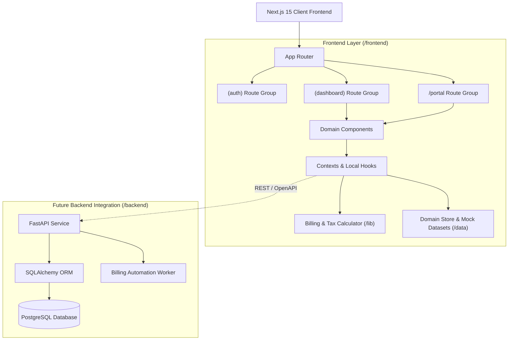

# SUBSENSE Architecture Specification

## 1. System Vision

SUBSENSE is an enterprise subscription and revenue management system designed to eliminate manual spreadsheet tracking, missed renewals, error-prone invoices, and untracked payments for modern recurring-revenue businesses.

---

## 2. Layered Architecture

---

## 3. Core Subsystems

### A. Subscription Lifecycle Manager
- **Status State Machine**:
  - `Draft`: Initial drafting stage; lines, customer, and term edits allowed.
  - `Quotation`: Formally issued quotation with expiry date countdown.
  - `Confirmed`: Approved by customer or rep; awaiting activation date.
  - `Active`: Live recurring billing active; periodic invoices automatically generated.
  - `Closed`: Terminated early, expired naturally, or manually completed.

### B. Billing & Invoice Automation Engine
- **Generation Trigger**: Automatically creates draft invoices on billing day for all active subscriptions.
- **Idempotency & Duplicate Prevention**: Checks period hashes `(subscription_id, period_start, period_end)` before creating invoices, ensuring no duplicate billing occurs.
- **Line Item Assembly**: Copies active subscription lines, evaluates active product-level or subscription-level discounts, and applies tax calculation rules.
- **Invoice Lifecycle**:
  - `Draft`: Generated and pending review.
  - `Confirmed`: Approved, invoice number locked, receivable entry created.
  - `Paid`: Full payment recorded against invoice.
  - `Cancelled`: Voided invoice; releases outstanding balance.

### C. Discount Rules Engine
- Supports fixed amount deductions ($ off) and percentage discounts (% off).
- Applies to either specific product lines or whole subscription totals.
- Respects validity dates (`validFrom`, `validTo`), minimum purchase/quantity thresholds, and maximum usage counters.
- Automatically rolls over to next billing invoices until criteria expire.

### D. Multi-Tier Security & RBAC
- Built-in role boundaries for `Admin`, `Staff`, and `Customer`.
- Strict password policy enforcement (>8 characters, uppercase, lowercase, special character).
